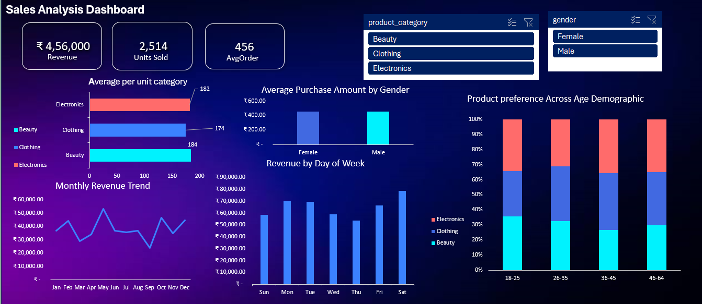

# Retail Sales Analysis Dashboard (Python + Excel)

An end-to-end data analysis project: raw retail transactions are cleaned in Python (pandas) and visualised in an interactive Excel dashboard with slicers.



## Business Questions
- How much revenue and how many units did the store generate?
- Which product categories perform best?
- Do men and women spend differently?
- Which days and months drive the most revenue?
- Which age groups prefer which categories?

## Dataset
- **Source:** Retail Sales Dataset (Kaggle) – 1,000 transactions, Jan 2023 – Jan 2024
- **Columns:** Transaction ID, Date, Customer ID, Gender, Age, Product Category, Quantity, Price per Unit, Total Amount

## Tools
Python (pandas, NumPy) · Jupyter Notebook (Anaconda) · Microsoft Excel (PivotTables, Slicers, Charts)

## Data Cleaning Steps (`notebooks/sales_data_cleaning.ipynb`)
1. Checked nulls and duplicates (none found)
2. Converted `Date` to datetime
3. Created `Month` and `Days` (day of week) columns
4. Standardised column names (lowercase, underscores)
5. Converted `gender`, `product_category` to category dtype; `age`, `quantity` to int8
6. Stripped whitespace from text columns
7. Validated `Quantity × Price per Unit = Total Amount` (0 mismatches)
8. Set `transaction_id` as index and exported the cleaned CSV

## Key Insights
- **Total revenue: 4,56,000** from **2,514 units**; average order value ≈ **456**
- **Electronics** (156,905) and **Clothing** (155,580) lead revenue; Beauty is lowest (143,515) but has the highest average order value (≈ 467)
- **Saturday** is the strongest day (78,815); **Thursday** is the weakest (53,835)
- **May** is the peak month (53,150); **September** is the lowest (23,620)
- Men (≈ 455) and women (≈ 457) spend almost the same per order
- Category preference shifts across age groups (see 100% stacked chart)

## Recommendations
- Run promotions on Thursdays and in September to lift weak periods
- Stock up and staff for Saturdays and May
- Target Beauty bundles/upsells since its order value is already the highest

## Repository Structure
```
retail-sales-excel-python-dashboard/
├── data/
│   ├── raw/retail_sales_dataset.csv
│   └── cleaned/cleaned_sales.csv
├── notebooks/sales_data_cleaning.ipynb
├── dashboard/sales_dashboard.xlsx
├── images/dashboard.png
└── README.md
```

## How to Use
1. Clone the repo: `git clone https://github.com/komalkhope20/retail-sales-excel-python-dashboard.git`
2. Open the notebook in Jupyter and run all cells (uses `data/raw/retail_sales_dataset.csv`)
3. Open `dashboard/sales_dashboard.xlsx` and use the slicers (product category, gender)

## Author
**Komal Khope** · [LinkedIn](https://www.linkedin.com/in/komal-khope-96749b316/) · khopekomal5@gmail.com
